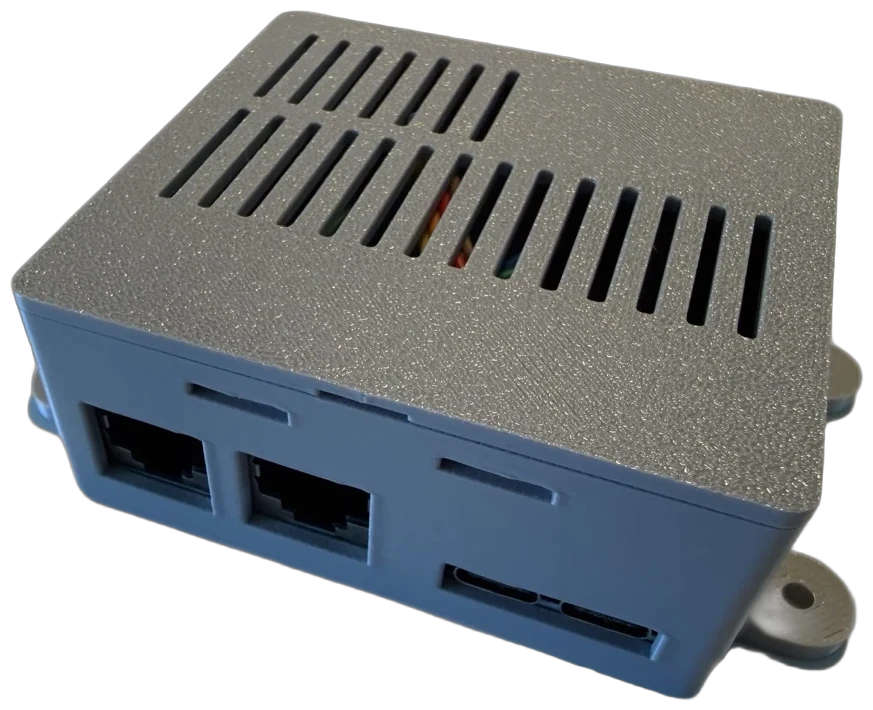
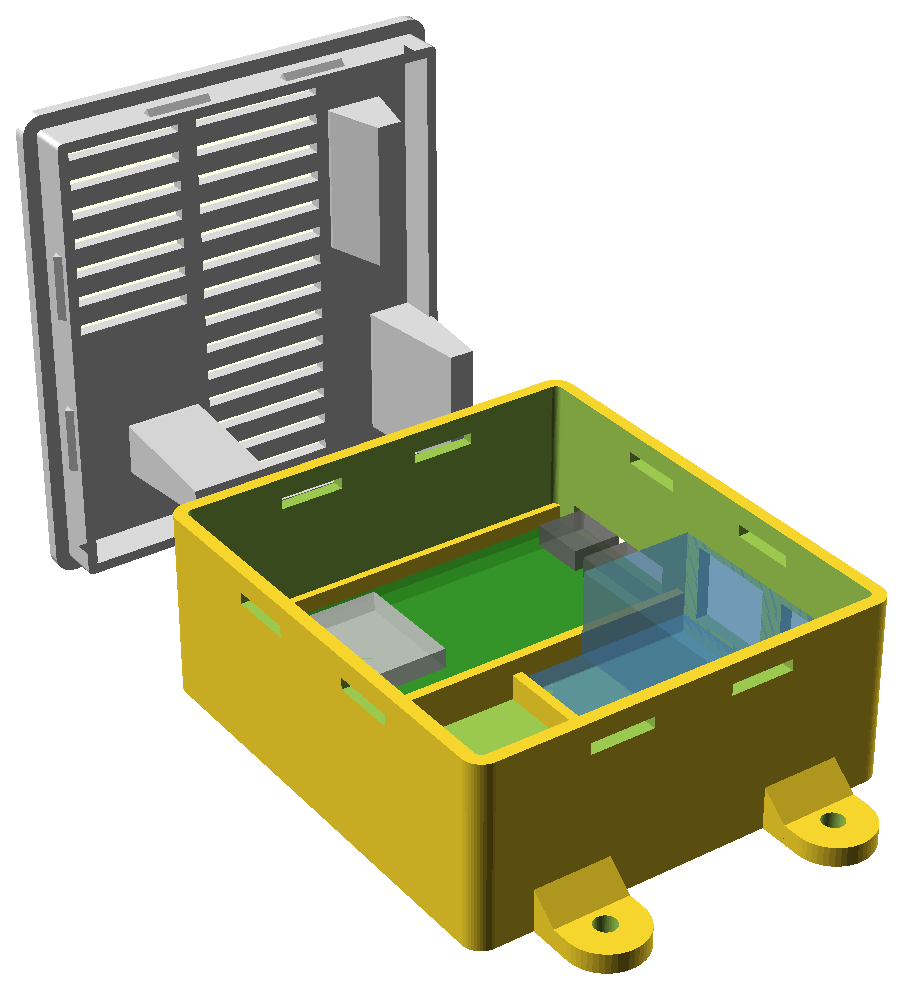
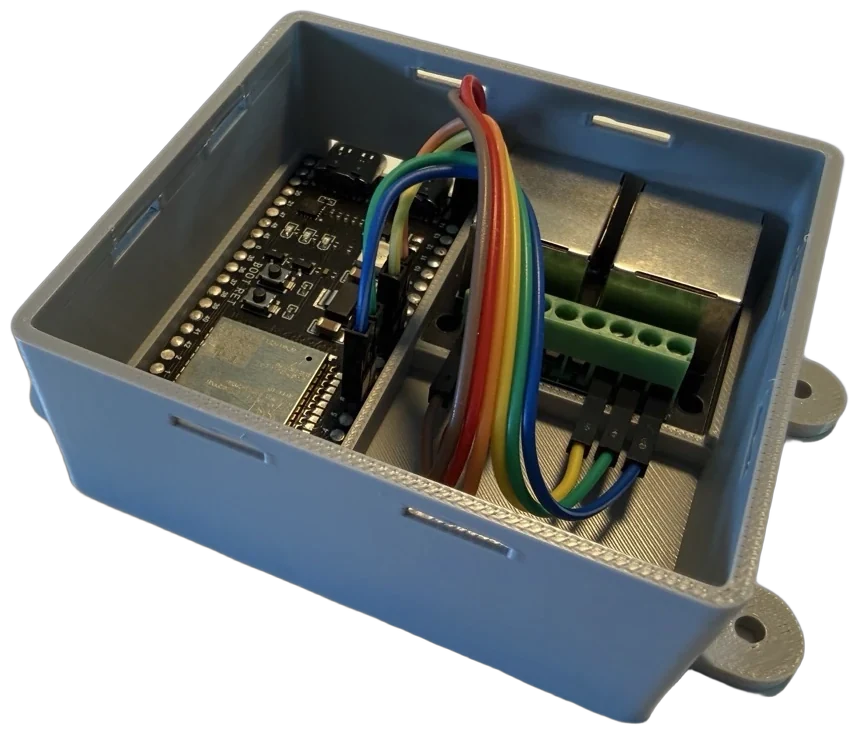
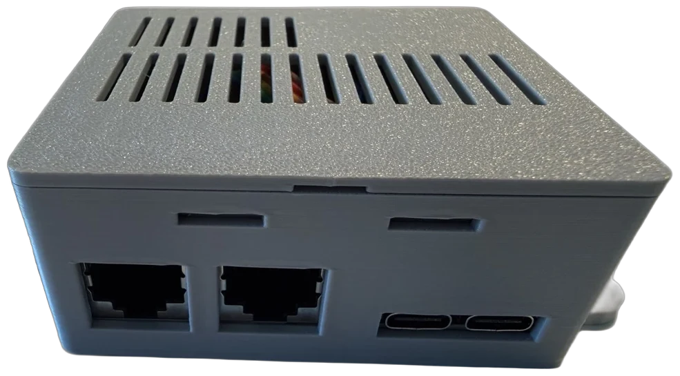

# Enclosure

A parametric, 3D-printable enclosure for the ESP32-S3 node (see
[../docs/HARDWARE.md](../docs/HARDWARE.md)).

<table align="center"><tr>
  <td align="center" width="50%">
    <br>
    <em>The printed enclosure, closed — the L-shaped vent grille on the lid, the RJ45 jacks and USB-C on the front, mounting ears on the sides.</em>
  </td>
  <td align="center" width="50%">
    <br>
    <em>How the parts sit inside (OpenSCAD render): the translucent boards are placeholders; the lid, drawn to the side, shows its L-shaped vent grille and hold-down tabs.</em>
  </td>
</tr></table>

> **This is the author's specific build, shared as a reference.** The model
> ([`enclosure.scad`](enclosure.scad)) is **fully parametric** — [export the STLs](#render--export)
> and print as-is if you used the same parts, or treat it as a starting point and update the
> measurements so it re-fits itself to yours.

Houses one **ESP32-S3-DevKitC-1** and the **double RJ45 breakout**, with a **snap-fit lid**. The
RJ45 jacks **and** the board's two USB-C connectors all exit the **same front wall**. The breakout's
two RJ45 jacks are **bridged** (wired in parallel), so **+5 V / GND** power and the **front-panel and
controller UART** lines all ride one Ethernet cable and appear on both jacks — use either, or split
the load across the two. The two **USB-C connectors** (native-USB host + UART/flash) stay reachable
for the USB-host link and flashing.

The RJ45 breakout drops into a **pocket** (front wall + left seat flange + the shared middle wall
as its right rib + a back rib); a hold-down tab on the lid underside clamps its top edge when the
lid closes — no fasteners.

The ESP32-S3 **lies flat** on the **floor** on its own soldered pin tails — **no under-board ledge**
to foul the bottom-side pins/solder. The **case length matches the board**, so the front and back
walls **butt its two ends** and stop it in Y (its USB-C shells seat in the front cutouts); in X it's
located between the **shared middle wall** (left) and a **seat flange** (right). Each board registers
on a flat seat flange along its outer edge rather than on a rounded wall corner (which can't seat a
board flat); the flanges stand `flange_proud` in from the side walls, widening the box slightly. Two
stout **hold-down tabs** on the lid press the board's **rigid parts**: a crossbar across both **USB-C
shells** at the front and a bar on the **RF shield can** at the back, clear of the antenna. No screws.

The WROOM **antenna** sits just inside the back wall — fine for normal use, but the plastic detunes
it a little. If WiFi range is poor (or the antenna overhangs the PCB edge on your board), raise
`esp_ant_clear` to move the back wall away.

Because the tabs press the board's centre line, they clear the edge pin-header rows, so **vertical
pin headers with dupont jumpers are fine**. The model ships sized for that (`esp_top_h = 15`, a
header + mated dupont, with `top_clear` above for the wire bend). Soldering the panel / controller /
power wires flat to the castellated pads instead? Drop `esp_top_h` to ~3 for the lowest box.
`esp_pin_h` sets how far the board sits off the floor on its pin tails (~2–3 mm).

Ventilation is one **L-shaped run of thin slots in the lid**, evenly spaced across the width. Every
slot has a front band segment (behind the front hold-down tabs, ending short of the rear module tab)
venting over the ESP board; the **left-half** slots also extend **toward the back** to form the L's
foot over the free space behind the RJ45 — split off the band by a crossbar for stiffness, cut at
the lid centreline so the foot stays symmetric. Four external **mounting ears** at the base (two per
long side) take M3 screws for flush surface mounting; disable with `mount_ears = false`.

<table align="center"><tr>
  <td align="center">
    <br>
    <em>The real build, lid off — the ESP32-S3 and double RJ45 breakout wired together with dupont jumpers, seated in the base.</em>
  </td>
  <td align="center">
    <br>
    <em>Front face: the two RJ45 jacks and the two USB-C connectors, with the snap slots above.</em>
  </td>
</tr></table>

## Before you print: measure

Defaults are the author's measured parts, **not necessarily yours** — the DevKitC-1 here is a wider
clone (`esp_w` 27.75 mm vs a genuine Espressif board's ~25.4 mm). Update every value marked
`// MEASURE` in `enclosure.scad`, especially:

- **ESP32-S3-DevKitC-1:** board length `esp_l` (front→back) × width `esp_w`, PCB thickness
  `esp_pcb_t`, `esp_comp_h` (RF-shield-can height — the rear tab presses here), `esp_top_h` (tallest
  obstruction above the PCB, sets the box height — raise to the dupont-tip height for headers),
  `esp_pin_h` (how far the board sits off the floor on its pin tails — sets the tab reach and USB-C
  window height), and `esp_ant_len` (antenna keep-out at the back end — the rear tab is derived to
  stay off it). `esp_ant_clear` is the gap to the back wall, near-zero so the case length matches the
  board; raise it for WiFi range or an overhanging antenna.
- **The two USB-C connectors:** `usb_span` (outer-to-outer, far side of one shell to far side of the
  other), `usb_conn_w` (one shell's width), `usb_body_h` (shell height above the PCB top). Each gets
  its own window + `usb_clear`; if the wall left between them would be thinner than `usb_min_div`
  they merge into one (they're ~2 mm apart on the DevKitC-1, so one window). The opening's height and
  height above the floor are **derived** from `esp_pin_h + esp_pcb_t`.
- **Double RJ45 breakout:** board L×W (`rj_l`/`rj_w`), the jack **window** W×H, plus `rj_jack_d`
  (jack-housing depth from the wall) and `rj_h` (floor to top of the housing) — the lid hold-down tab
  lands on the housing top using these two.
- **S3 hold-down tabs:** the front crossbar (`usb_hold_*`) presses both USB-C shells; the rear bar
  (`mod_hold_*`) presses the RF shield can (position derived from `esp_ant_len` to stay off the
  antenna). Check they land on those rigid parts for your board — adjust `usb_hold_yoff` / `esp_ant_len`
  if its layout differs.

The interior footprint and height are **derived** from these, so the box resizes itself to fit —
compact and near-square, with the RJ45 windows on the front-wall left and the USB-C window on the
right. The RJ45 and the S3 **sit up against each other**, sharing one wall (the RJ45 pocket's right
rib is also the S3's left locating wall), each registered on a flat **seat flange** along its outer
edge. No cable channel — the dupont wires route over the low shared wall and through the empty space
behind the RJ45.

## Adapt it for your build

Different S3 board, a USB-C cutout on a different wall, a DIN-rail clip — the model is meant to be
changed. Two ways in:

- **By hand:** open [`enclosure.scad`](enclosure.scad) in OpenSCAD, edit the named variables at the
  top (start with everything marked `// MEASURE`), press F5 to preview, then re-export (below).
- **With AI:** the whole model is a single, commented, plain-text `.scad` file — a good fit for an
  AI coding assistant. Point a tool like Claude Code at this folder, describe your parts and what you
  want changed, and iterate. Always render and eyeball the result — and dry-fit a print — before
  trusting it; AI gets dimensions and clearances wrong.

## Render / export

```sh
# Preview with translucent board + connector placeholders (OpenSCAD GUI, F5)
openscad enclosure.scad

# Export the two print parts
openscad -o base.stl -D 'part="base";' enclosure.scad
openscad -o lid.stl  -D 'part="lid";'  enclosure.scad
```

`part` can be `"preview"` (default), `"base"`, `"lid"`, or `"both"`.

## Printing notes

- **Orientation:** print both parts flat (base floor-down, lid top-down), normally no supports.
  The front-wall openings print as **bridges** (top edge anchored both sides): the RJ45 windows are
  split by a divider (`rj_win_gap`) into short spans, the merged USB-C window is a single ~21 mm span,
  and the snap slots (and side-wall vent slots, if enabled) are all narrow — they bridge cleanly on
  most printers with part cooling. If yours sags, add supports for the **base only** (the scars land
  hidden inside the openings). The lid needs no supports: its vent slots are through-holes in the flat
  plate, and the snap teeth and three hold-down tabs are sloped or vertical.
- **Material:** PLA or PETG, 3 perimeters, 20 % infill.
- **Snap fit is printer-dependent.** Print the **lid first** and test the click. Too tight → raise
  `fit_clear` or lower `snap_depth`; too loose → the reverse. `snap_n_short` / `snap_n_long` set the
  teeth per short/long wall. A tiny **channel under the lid's front edge** (`lid_grip`), hidden from
  the top, lets a nail catch under the lip to lift it off.
- **S3 fit:** the board sits on the floor (on its pin tails, `esp_pin_h`), located in X between the
  shared middle wall (left) and the **seat flange** (right) — `s3_fit` is the edge gap to each,
  `flange_proud` how far the flanges stand in from the walls (larger = wider box) — and in Y by the
  front/back walls butting its ends. The lid tabs (`s3_hold`) press it down — check they land on the
  USB-C shells and shield can, and that the rear tab clears the antenna. The outer-edge header sits
  close to the flange, so plug that dupont row before dropping the board in.
- **RJ45 fit:** the board drops into its pocket (`rj_rib_*`, `rj_backrib_h`); the lid tab
  (`rj_hold_*`) clamps the jack housing. No fasteners needed.
- **Ventilation:** `vent_w` / `vent_gap` set the slot width and pitch, `vent_edge` the margin from
  the side walls; the slot run fills the width and the L (left-half slots long, right-half short)
  tracks the tabs automatically. `lid_vents = false` seals it.
- **Mounting ears:** `mount_ears` toggles them; `mount_hole_d` sets the screw size, `mount_ext` /
  `mount_ear_w` / `mount_inset` the shape and spacing, `mount_gusset` the brace height.
